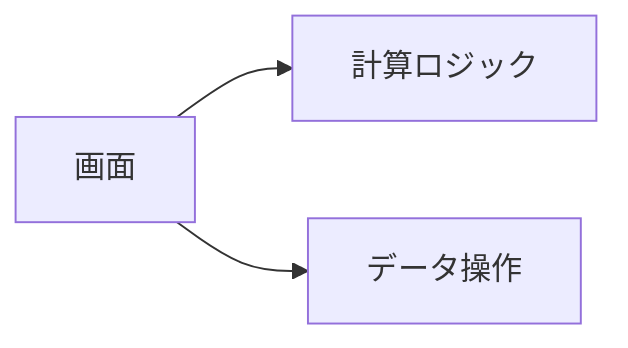
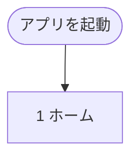

# 基本設計書：（アプリの名前）

| 項目 | 内容 |
|---|---|
| 版数 | 第1.0版 |
| 作成日 | YYYY-MM-DD |
| 元にした文書 | 要件定義書 第○版（`仕様書/要件定義書.md`） |
| 次の工程 | デザイン仕様書 → 実装 |

---

## 1. この文書の目的と範囲

| 章 | 内容 |
|---|---|
| 2 | 使う技術と、アプリ全体の構成 |
| 3 | 画面の一覧、画面遷移、各画面の項目、レイアウトの切り替え条件 |
| 4 | 保存するデータの形式、移行、バックアップ・書き出しの形式 |
| 5 | 計算ロジック |
| 6 | 外部連携 |
| 7 | 公開と更新 |
| 8 | 非機能要件の実現方針 |
| 9 | 要件定義書の未決事項への回答と、残っている課題 |

---

## 2. システム構成

### 2.1 使う技術
| 分類 | 採用する技術 | 選んだ理由 |
|---|---|---|
| 言語 | | |
| 画面 | | |
| ビルド | | |
| 画面の切り替え | | |
| データ保存 | | |
| テスト | | |
| 公開 | | |

### 2.2 全体の構成


### 2.3 プログラムの分け方
| 層 | 役割 | 依存してよい先 |
|---|---|---|
| 画面 | | |
| 計算ロジック | 画面にもデータベースにも依存しない普通の関数。現在時刻は引数で受け取る | なし |
| データ操作 | | |
| 端末機能 | | |

---

## 3. 画面設計

### 3.1 画面一覧とURL
| No | 画面 | URL | 主な内容 |
|---|---|---|---|
| 1 | | | |

### 3.2 画面遷移図


### 3.3 各画面の項目
#### 1. （画面の名前）
| 項目 | 内容 | 関連する要件 |
|---|---|---|
| | | |

### 3.4 レイアウトの切り替え条件
| 名称 | 条件 | レイアウト |
|---|---|---|
| | | |

---

## 4. データ設計

### 4.1 共通のルール
| 項目 | ルール |
|---|---|
| データベース名 | |
| 時刻 | エポックミリ秒（数値） |
| 日付 | 端末の時間帯での `YYYY-MM-DD` |
| 共通の項目 | `id`、`createdAt`、`updatedAt`、`deleted` |

### 4.2 テーブル一覧
| テーブル | 内容 | 主な索引 |
|---|---|---|
| | | |

### 4.3 各テーブルの項目
#### （テーブル名）
| 項目 | 型 | 内容 |
|---|---|---|
| | | |

### 4.4 データ形式の移行
| 版 | 変更内容 |
|---|---|
| 1 | 最初の形式 |

### 4.5 バックアップ・書き出しの形式

---

## 5. 計算ロジック

### 5.1 （計算の名前）
```
（式）
```
- 端数の処理：
- 計算例：（実際に計算した値）

---

## 6. 外部連携

### 6.1 確認できたこと（実機・公式情報）
| 項目 | 結果 | 確認した日 |
|---|---|---|
| | | |

### 6.2 受け渡しの形式

### 6.3 手順と、間違えやすい点

---

## 7. 公開と更新

### 7.1 公開先とURL
### 7.2 アプリの設定（マニフェストなど）
### 7.3 オフラインと更新の流れ
### 7.4 公開（デプロイ）の流れ

---

## 8. 非機能要件の実現方針

| 分類 | 実現方法 |
|---|---|
| 使いやすさ | |
| 性能 | |
| 信頼性 | |
| セキュリティ | |
| 保守性 | |

---

## 9. 要件定義書の未決事項への回答と、残っている課題

### 9.1 未決事項への回答
| No | 内容 | 回答 |
|---|---|---|
| | | |

### 9.2 残っている課題
| No | 内容 | 決める時期 |
|---|---|---|
| | | |

---

## 10. 変更履歴

| 版数 | 日付 | 内容 |
|---|---|---|
| 1.0 | YYYY-MM-DD | 初版作成 |
