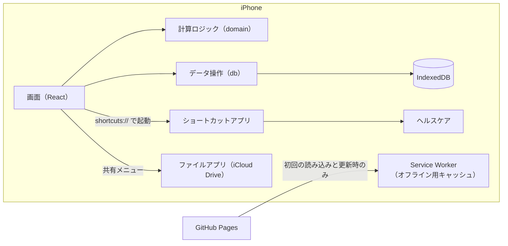
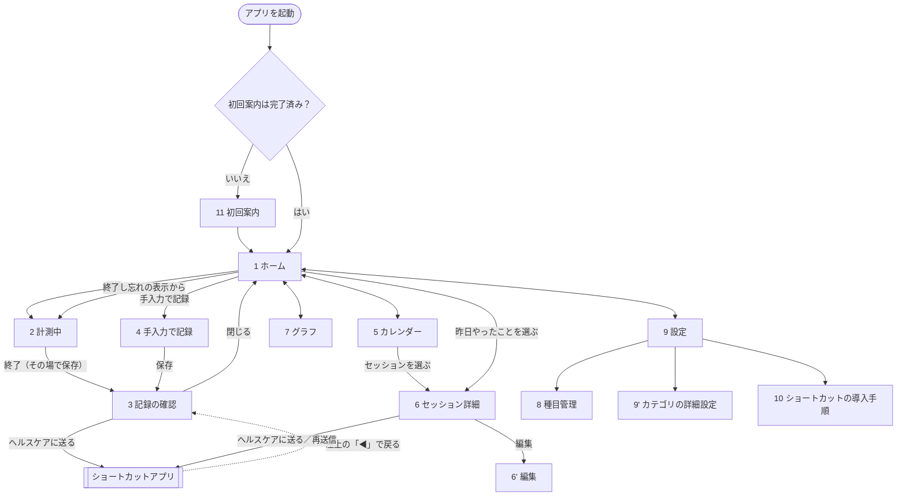
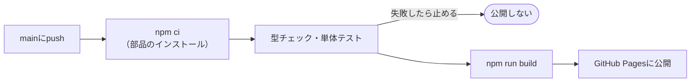

# 基本設計書：筋力トレーニング記録アプリ（PWA版）

| 項目 | 内容 |
|---|---|
| 版数 | 第1.0版 |
| 作成日 | 2026-11-03 |
| 元にした文書 | 要件定義書 第2.3版（`仕様書/要件定義書.md`） |
| 次の工程 | デザイン仕様書（配色・部品・人体図の部位定義）→ 実装 |

---

## 1. この文書の目的と範囲

要件定義書で決めた「何を作るか」を、「どう作るか」に落とし込みます。実装を始めるときに迷わないよう、次の内容を決めます。

| 章 | 内容 |
|---|---|
| 2 | 使う技術と、アプリ全体の構成 |
| 3 | 画面の一覧、画面遷移、各画面の項目、レイアウトの切り替え条件 |
| 4 | 保存するデータの形式、バックアップファイル・CSVの形式 |
| 5 | 計算ロジック（日付の区切り、カロリー、回復状況、筋肉痛の確認など） |
| 6 | ショートカットを使ったヘルスケア連携 |
| 7 | PWAの設定、更新の流れ、公開（デプロイ）の流れ |
| 8 | 非機能要件をどう実現するか |
| 9 | 要件定義書の未決事項への回答と、残っている課題 |

色・文字サイズ・部品の見た目・人体図の絵柄は、デザイン仕様書で決めます。

---

## 2. システム構成

### 2.1 使う技術

| 分類 | 採用する技術 | 選んだ理由 |
|---|---|---|
| 言語 | TypeScript | 型チェックで、データ構造の間違いを実装中に見つけられる |
| 画面 | React（関数コンポーネント＋Hooks） | 情報と部品が最も多く、実装が安定する（未決事項No.3で決定） |
| ビルド | Vite | 起動と再読み込みが速い。PWAプラグインがある |
| PWA化 | vite-plugin-pwa（Workbox） | マニフェストとService Workerを自動で生成できる |
| 画面の切り替え | React Router（ハッシュ方式：`#/calendar` など） | GitHub Pagesでは、画面のURLを直接開いたり再読み込みしたりすると404になる。ハッシュ方式にすれば、この問題が起きない |
| データ保存 | IndexedDB＋Dexie.js＋dexie-react-hooks | IndexedDBを簡単に扱える。データが変わると画面が自動で更新される（`useLiveQuery`） |
| グラフ | Chart.js＋react-chartjs-2 | 棒グラフ・折れ線グラフを少ない設定で作れる |
| 人体図 | インラインSVG（部位ごとに `id` を付ける） | 部位ごとに色を変えたり、タップを検知したりできる |
| 日付の計算 | date-fns | 日・週・月の区切りを、端末の時間帯（日本時間）で正しく計算できる |
| 見た目 | CSS Modules＋CSS変数 | 外部ライブラリを使わずに、ダークモードと画面幅による切り替えができる |
| テスト | Vitest | Viteと同じ設定で動く。計算ロジックの単体テストに使う |
| 公開 | GitHub Pages＋GitHub Actions | 要件定義書 6章で確定済み |

- 一意のIDは、ブラウザ標準の `crypto.randomUUID()` で作ります（iOS 15.4以降で使えます）。
- サーバー、外部の解析ツール、広告は使いません。

### 2.2 全体の構成



### 2.3 プログラムの分け方

保守性の要件（計算ロジックを画面から分けて、単体テストができるようにする）を満たすため、次の4つの層に分けます。具体的なフォルダ構成と命名規則は、開発ルール（CLAUDE.md）で決めます。

| 層 | 役割 | 依存してよい先 |
|---|---|---|
| 画面（ui / features） | 画面の表示と操作の受け付け | 計算ロジック、データ操作、端末機能 |
| 計算ロジック（domain） | カロリー、回復状況、日付の区切り、集計など。**画面にもデータベースにも依存しない、普通の関数だけで作る** | なし |
| データ操作（db） | Dexieの定義、読み書き、データ形式の移行、バックアップと復元 | 計算ロジック（型だけ） |
| 端末機能（platform） | ショートカットの起動、ファイルの共有、永続ストレージの要求、ホーム画面から起動しているかの判定 | なし |

---

## 3. 画面設計

### 3.1 画面一覧とURL

| No | 画面 | URL（`#` 以降） | 主な内容 |
|---|---|---|---|
| 1 | ホーム | `/` | 人体図、開始ボタン（計測中は「計測中の画面へ」）、昨日やったこと、各種のお知らせ |
| 2 | 計測中 | `/session/active` | 経過時間、カテゴリ・種目の選択、メモ、終了ボタン |
| 3 | 記録の確認 | `/session/:id/done` | 保存した内容、推定カロリー、「ヘルスケアに送る」ボタン |
| 4 | 手入力で記録 | `/session/new` | 日時・所要時間・カテゴリ・種目・メモを入力して保存 |
| 5 | カレンダー | `/calendar` | 月表示、日付ごとのセッション一覧 |
| 6 | セッション詳細 | `/session/:id` | 内容、人体図、ヘルスケアへの送信状況、編集・削除 |
| 6' | セッションの編集 | `/session/:id/edit` | 手入力画面（No.4）と同じ部品を使う |
| 7 | グラフ | `/stats` | 週・月・年の切り替え、各指標 |
| 8 | 種目管理 | `/settings/exercises` | 種目の一覧、追加、編集、非表示、お気に入り |
| 9 | 設定・プロフィール | `/settings` | プロフィール、回復目安・METs、ヘルスケア連携、バックアップ・復元、CSVの書き出し |
| 9' | カテゴリの詳細設定 | `/settings/categories` | カテゴリごとの回復目安時間・METs・回復管理のオン・オフ、筋肉痛の補正値 |
| 10 | ショートカットの導入手順 | `/settings/shortcut` | ショートカットの入手方法、作り方、動作確認 |
| 11 | 初回案内 | `/welcome` | ホーム画面への追加方法、体重の入力、バックアップの説明 |

- 画面下部のタブ（iPhone）と左側のメニュー（iPad・PC）には、「ホーム」「カレンダー」「グラフ」「設定」の4つを置きます。
- 計測中・記録の確認・手入力・編集の画面では、タブとメニューを隠し、操作に集中できるようにします。

### 3.2 画面遷移図



- 「手入力で記録」の入り口は、ホームの開始ボタンの近く（小さめのリンク）と、カレンダーの日付一覧（その日を初期値にする）の2か所に置きます。

### 3.3 各画面の項目

#### 1. ホーム
上から次の順に表示します。お知らせは、出す条件を満たしたものだけを表示します。

| 順 | 部品 | 内容 | 関連する要件 |
|---|---|---|---|
| 1 | お知らせ：更新 | 「新しい版があります［更新する］」 | 非機能・更新 |
| 2 | お知らせ：終了し忘れ | 「開始から3時間以上たっています。終了し忘れていませんか？」［終了時刻を指定して保存］［続ける］ | F-REC-08 |
| 3 | お知らせ：筋肉痛の確認 | 部位ごとに［なし］［軽い］［強い］。［あとで］を押すと、次に起動するまで表示しない | F-BODY-05 |
| 4 | お知らせ：バックアップ | 「最後のバックアップから7日たちました［今すぐバックアップ］」 | F-DATA-05 |
| 5 | お知らせ：ヘルスケア未送信 | 「ヘルスケアに送っていない記録が◯件あります」（連携がオンのときだけ） | F-HLT-03 |
| 6 | 開始ボタン | 大きなボタン。計測中は経過時間を表示し、押すと計測中の画面に移る | F-REC-01 |
| 7 | 人体図 | 前面・背面。部位をタップすると、最後に鍛えた日時、回復予定時刻、残り時間を表示する | F-BODY-01、02 |
| 8 | 昨日やったこと | 日付、カテゴリ、所要時間、カロリー。押すとセッション詳細に移る | F-CALD-03 |
| 9 | 続けてきた記録 | 連続日数、今月のトレーニング日数 | F-CALD-04 |

起動してから2タップ以内に開始する（非機能・使いやすさ）ため、開始ボタンは最初の画面内に必ず表示します。

#### 2. 計測中
| 項目 | 内容 |
|---|---|
| 経過時間 | `00:42:15` の形式。1秒ごとに更新する（5.2） |
| カテゴリの選択 | 筋トレ系・ケア系に分けたボタンの一覧。複数選べる。［前回と同じ］ボタンで、前回のカテゴリと種目をまとめて選ぶ（F-REC-09） |
| 種目の選択 | 選んだカテゴリの種目を表示する（任意、複数選べる）。お気に入りを上に、非表示にした種目は出さない |
| メモ | 1行（最大100文字） |
| 終了ボタン | カテゴリを1つ以上選ぶまでは押せない。押すとその場で保存して、記録の確認画面に移る |
| 取り消し | 「記録を破棄」。確認してから計測中のデータを消す |

選んだ内容は、選ぶたびにすぐ端末内に保存します（アプリが終了しても途切れないように。F-REC-05）。

#### 3. 記録の確認
| 項目 | 内容 |
|---|---|
| 日時 | 開始〜終了の時刻、所要時間 |
| 内容 | カテゴリ、種目、メモ |
| 推定カロリー | 「約◯kcal（推定値）」（F-CAL-05） |
| 人体図 | このセッションで使った部位（小さく表示） |
| ヘルスケアに送る | 連携がオンのときだけ表示する（6章） |
| 操作 | ［編集］［閉じる］ |

#### 4. 手入力で記録（6' 編集も共通）
| 項目 | 入力の仕方 | チェック |
|---|---|---|
| 開始日 | 日付を選ぶ（初期値：今日。カレンダーから来た場合はその日） | 未来の日付は選べない |
| 開始時刻 | 時刻を選ぶ | 開始日時が未来にならないこと |
| 所要時間 | 分で入力する（5分単位の候補ボタン＋数字入力） | 1〜600分 |
| カテゴリ・種目・メモ | 計測中の画面と同じ部品 | カテゴリが1つ以上 |

- 編集で日時・カテゴリ・種目を変えた場合は、カロリーを計算し直します。体重は保存したときの値のままにします（F-CAL-04）。
- ヘルスケアに送信済みの記録を編集・削除するときは、「ヘルスケアの記録は変わりません。必要ならヘルスケアアプリで直してください」と表示します（3.7の注意書き）。

#### 5. カレンダー
| 項目 | 内容 |
|---|---|
| 月の切り替え | ［＜］［＞］、［今日］ |
| 日付の印 | 筋トレ系を含む日と、ケア系だけの日で色を変える（F-CALD-01）。同じ日に両方あれば筋トレ系の色にする |
| 日付を選んだとき | その日のセッション一覧（開始〜終了、所要時間、カテゴリ、種目、カロリー）。［この日に手入力で記録］ |

日付は、セッションの**開始日時の日付**で決めます（5.1）。

#### 6. セッション詳細
記録の確認画面と同じ内容に、次の項目を加えます。

- ヘルスケアの送信状況：「未送信」または「送信済み（11/3 21:40）」。［ヘルスケアに送る］または［もう一度送る］
- ［編集］［削除］。削除は確認してから行い、データには「削除済み」の印を付ける（4.1）

#### 7. グラフ
| 項目 | 内容 |
|---|---|
| 期間 | ［週］［月］［年］の切り替えと、前後の期間への移動。週は月曜始まり |
| 指標 | トレーニング日数、合計時間、合計消費カロリーを棒グラフで表示（週・月は日ごと、年は月ごと）。期間の合計も数字で表示する |
| カテゴリ別の回数 | カテゴリごとの実施回数を横棒グラフで表示（F-GRA-03） |
| 体重の推移 | 折れ線グラフ（Could。体重の入力履歴から作る） |

#### 8. 種目管理
| 項目 | 内容 |
|---|---|
| 一覧 | カテゴリごとに表示。お気に入りの印、非表示の印 |
| 追加・編集 | 名称（必須、30文字まで）、カテゴリ、強度［低・中・高］（F-MST-02） |
| 削除 | 記録で使っていない独自の種目は削除する。使っている種目とプリセット種目は「非表示」にする（F-MST-03、04） |

#### 9. 設定・プロフィール
| グループ | 項目 |
|---|---|
| プロフィール | ニックネーム、体重（必須、20〜300kg、0.1kg単位）、身長、生年月日、性別（任意） |
| トレーニング | カテゴリの詳細設定（9'）、種目管理（8）、終了し忘れと判断するまでの時間（1〜12時間） |
| ヘルスケア連携 | 連携のオン・オフ、ショートカットの名前、保存後に自動で送る（Could）、導入手順（10） |
| データ | バックアップの書き出し、復元、CSVの書き出し、最後にバックアップした日時、バックアップを促すまでの日数（1〜30日）、永続ストレージの状態 |
| アプリについて | 版数、「推定値であり医学的な助言ではありません」という注意書き |

#### 11. 初回案内
1. Safariのタブで開いている場合（5.9）：ホーム画面に追加する手順を案内し、「ホーム画面から開き直してください」と表示する。ここから先へは進めない（データの保存場所が別になるため。要件定義書 7.1）
2. ホーム画面から開いている場合：ニックネームと体重を入力する
3. データは端末内にしかないこと、定期的にバックアップが必要なことを説明する
4. 永続ストレージを要求する（7.4）。完了したらホームへ移る

PCのブラウザ（Chrome・Edge）では、開発中の確認のため、手順1を飛ばせるようにします。

### 3.4 レイアウトの切り替え条件

要件定義書 3.10の表に、**画面の高さ**による条件を加えます（未決事項No.8で決定）。

| 名称 | 条件 | レイアウト |
|---|---|---|
| コンパクト | 幅768px未満、**または高さ600px未満** | 1列表示、画面下部にタブ |
| ワイド | 幅768px以上、かつ高さ600px以上 | 左側にメニュー、ホームなどは2列表示。中身の最大幅は1200px |

```css
/* ワイドのときだけ適用する */
@media (min-width: 768px) and (min-height: 600px) { ... }
```

- 横向きのiPhone（高さはおよそ320〜440px）はコンパクトになり、縦向きと同じ下部タブのまま表示されます。
- iPad（縦向き・横向き）、iPadのSplit View、PCのウィンドウは、幅でそのまま判定されます。
- 判定はCSSのメディアクエリで行うため、回転したりウィンドウの大きさを変えたりすると、すぐに切り替わります（F-RESP-01）。
- ノッチとホームバーに表示が重ならないよう、`env(safe-area-inset-*)` で余白を取ります。

---

## 4. データ設計

### 4.1 共通のルール

| 項目 | ルール |
|---|---|
| データベース名 | `dat-training`（このアプリ専用の接頭辞 `dat-`。同じドメインのほかのサイトと衝突させないため。要件定義書 7.1） |
| localStorage | 使わない（すべてIndexedDBに保存する） |
| 時刻 | エポックミリ秒（1970-01-01からの経過ミリ秒。数値）で保存する。時間帯に左右されず、比較と計算が簡単なため |
| 日付 | `YYYY-MM-DD` の文字列（端末の時間帯での日付）。カレンダーなどの集計に使う |
| 共通の項目 | 次の表の項目を、記録・種目など同期の対象になるデータすべてに持たせる（F-DATA-08） |

| 共通の項目 | 型 | 内容 |
|---|---|---|
| `id` | 文字列 | UUID。プリセットのデータだけは固定のID（4.3） |
| `createdAt` | 数値 | 作成した時刻 |
| `updatedAt` | 数値 | 最後に変更した時刻 |
| `deleted` | 0 または 1 | 削除済みの印。画面には出さないが、データは残す |

`deleted` を真偽値ではなく0と1にするのは、IndexedDBの索引（検索を速くする仕組み）が真偽値に対応していないためです。

### 4.2 テーブル一覧

| テーブル | 内容 | 主な索引 |
|---|---|---|
| `sessions` | トレーニングの記録（1セッションが1件） | `localDate`、`startAt`、`deleted` |
| `categories` | カテゴリ（10件。初回起動時に登録） | ― |
| `exercises` | 種目（プリセット＋独自） | `categoryId` |
| `sorenessLogs` | 筋肉痛の回答 | `[sessionId+categoryId]` |
| `weightLogs` | 体重の入力履歴 | `date` |
| `settings` | 設定とプロフィール（1件だけ。キーは `app`） | ― |
| `activeSession` | 計測中のセッション（0件または1件。キーは `current`） | ― |
| `meta` | 管理用の値（データ形式の版、最後にバックアップした時刻など） | ― |

### 4.3 各テーブルの項目

#### sessions（トレーニングの記録）
| 項目 | 型 | 内容 |
|---|---|---|
| （共通の項目） | | |
| `startAt` | 数値 | 開始時刻 |
| `endAt` | 数値 | 終了時刻。所要時間は `endAt − startAt` で求める |
| `localDate` | 文字列 | 開始時刻の、端末の時間帯での日付（5.1）。保存・編集のたびに計算し直す |
| `source` | `timer` / `manual` | 計測して記録したか、手入力したか |
| `categoryIds` | 文字列の配列 | 実施したカテゴリ（1つ以上） |
| `exercises` | 配列 | 実施した種目。`{ exerciseId: 文字列, sets: null }` の形。`sets` は将来、重量・回数・セット数を入れるために用意しておく（F-REC-11） |
| `memo` | 文字列 | 1行メモ（空文字でもよい） |
| `weightKg` | 数値 | 保存したときの体重（F-CAL-04） |
| `mets` | 数値 | カロリー計算に使ったMETs（5.3）。あとで設定を変えても、過去のカロリーが変わらないようにする |
| `kcal` | 数値 | 推定カロリー（整数） |
| `healthSentAt` | 数値 または null | ヘルスケアに送った時刻。未送信ならnull |

将来の `sets` の形（予定）：`[{ weightKg: 数値 または null, reps: 数値 }]`。1要素が1セットです。

#### categories（カテゴリ）
| 項目 | 型 | 内容 |
|---|---|---|
| （共通の項目） | | |
| `id` | 文字列 | 固定ID：`chest` 大胸筋、`back` 背中、`legs` 下半身、`shoulders` 肩、`arms` 腕、`abs` 腹筋、`posture` 反り腰、`hip` 股関節、`neck` スマホ首、`face` 小顔 |
| `name` | 文字列 | 表示名 |
| `group` | `strength` / `care` | 筋トレ系、ケア系 |
| `recoveryEnabled` | 真偽値 | 回復を管理するか（初期値：筋トレ系はtrue、ケア系はfalse） |
| `recoveryHours` | 数値 | 回復目安時間（初期値は要件定義書 3.2.1。ケア系は24時間を入れておく） |
| `mets` | 数値 | METs（初期値は要件定義書 3.2.1） |
| `bodyRegions` | 文字列の配列 | 人体図で色を付ける部位のID。部位のIDはデザイン仕様書で決める |
| `sortOrder` | 数値 | 並び順 |

#### exercises（種目）
| 項目 | 型 | 内容 |
|---|---|---|
| （共通の項目） | | |
| `id` | 文字列 | プリセットは固定ID（例：`p-chest-01`）、独自の種目はUUID |
| `categoryId` | 文字列 | 所属するカテゴリ |
| `name` | 文字列 | 名称 |
| `isPreset` | 真偽値 | プリセットかどうか |
| `intensity` | `low` / `mid` / `high` または null | 独自の種目の強度。プリセットはnull |
| `mets` | 数値 | プリセット：所属カテゴリの初期METsと同じ値。独自：強度から換算（5.3） |
| `hidden` | 真偽値 | 非表示 |
| `favorite` | 真偽値 | お気に入り |
| `sortOrder` | 数値 | 並び順 |

プリセットを固定IDにするのは、バックアップから復元したり、将来ほかの端末と同期したりしたときに、同じ種目を同じものとして扱えるようにするためです。

#### sorenessLogs（筋肉痛の回答）
| 項目 | 型 | 内容 |
|---|---|---|
| （共通の項目） | | |
| `sessionId` | 文字列 | 対象のセッション |
| `categoryId` | 文字列 | 対象のカテゴリ |
| `level` | `none` / `light` / `strong` | なし・軽い・強い |

#### weightLogs（体重の履歴）
| 項目 | 型 | 内容 |
|---|---|---|
| （共通の項目） | | |
| `date` | 文字列 | 入力した日（`YYYY-MM-DD`）。同じ日に何度入力しても、その日の1件を上書きする |
| `weightKg` | 数値 | 体重 |

現在の体重は、`weightLogs` の最新の1件とします。

#### settings（設定。キー `app` の1件だけ）
| 項目 | 型 | 初期値 |
|---|---|---|
| `nickname` | 文字列 | 空 |
| `heightCm`、`birthDate`、`sex` | 任意 | null |
| `sorenessAdjustHours` | `{ none, light, strong }` | `{ none: 0, light: 12, strong: 24 }` |
| `forgotEndHours` | 数値 | 3 |
| `backupReminderDays` | 数値 | 7 |
| `healthEnabled` | 真偽値 | true |
| `shortcutName` | 文字列 | `筋トレ記録をヘルスケアへ`（6.3） |
| `autoSendToHealth` | 真偽値 | false（F-HLT-06、Could） |
| `setsInputEnabled` | 真偽値 | false（F-SET-05、将来用） |
| `onboardingDone` | 真偽値 | false |
| `updatedAt` | 数値 | ― |

#### activeSession（計測中。キー `current`）
| 項目 | 型 | 内容 |
|---|---|---|
| `startAt` | 数値 | 開始時刻 |
| `categoryIds`、`exercises`、`memo` | sessionsと同じ | 計測中に選んだ内容 |

終了するときは、1つのトランザクション（一連の処理をまとめて、途中で失敗したら全部取り消す仕組み）の中で、`sessions` への追加と `activeSession` の削除を行います。

#### meta（管理用の値）
| キー | 内容 |
|---|---|
| `schemaVersion` | データ形式の版（最初は1） |
| `firstLaunchAt` | 初回起動の時刻 |
| `lastBackupAt` | 最後にバックアップを書き出した時刻 |

### 4.4 データ形式の移行
- Dexieの版管理（`db.version(n).upgrade(...)`）で、データ形式を変えたときに既存のデータを自動で新しい形式に直します（非機能・信頼性）。
- 移行の処理には必ず単体テストを書きます。
- 初回起動時に、カテゴリとプリセット種目を登録します（F-MST-01）。版が上がってプリセットが増えた場合は、足りないものだけを追加し、利用者が変えた値は上書きしません。

### 4.5 バックアップファイル（JSON）
| 項目 | 内容 |
|---|---|
| ファイル名 | `training-backup-YYYYMMDD-HHmm.json` |
| 文字コード | UTF-8 |
| 中身 | 下の例のとおり。削除済みのデータも含める（将来の同期で必要になるため） |

```json
{
  "app": "dat-training",
  "format": 1,
  "schemaVersion": 1,
  "exportedAt": 1793710800000,
  "data": {
    "sessions": [],
    "categories": [],
    "exercises": [],
    "sorenessLogs": [],
    "weightLogs": [],
    "settings": [],
    "activeSession": []
  }
}
```

**書き出し（F-DATA-03）**
1. 全テーブルを読み、上の形にまとめる
2. 共有メニュー（Web Share APIの `navigator.share({ files })`）を開く。iPhoneでは「"ファイル"に保存」からiCloud Driveに保存できる
3. 共有メニューが使えない環境（PCなど）では、ファイルとしてダウンロードする
4. 共有が完了したら `meta.lastBackupAt` を更新する。途中で取り消された場合は更新しない

**復元（F-DATA-04）**
1. ファイルを選ぶ
2. 中身を確認する（`app` が `dat-training` か、`format` に対応しているか、必須の項目があるか）。おかしければ、何も変えずにエラーを表示する
3. 「現在のデータはすべて置き換わります」と、ファイル内の記録の件数・期間を表示して確認する
4. 1つのトランザクションで、全テーブルを空にしてから書き込む。途中で失敗したら、元の状態に戻す
5. `schemaVersion` が古いファイルは、4.4と同じ移行処理をかけてから書き込む

### 4.6 CSVの書き出し（F-DATA-07）
1行が1セッションです。削除済みのセッションは含めません。

| 列 | 例 |
|---|---|
| 日付 | 2026-11-03 |
| 開始 | 21:00 |
| 終了 | 21:35 |
| 所要時間（分） | 35 |
| カテゴリ | 大胸筋／腕（「／」区切り） |
| 種目 | 腕立て伏せ／ダンベルカール |
| 消費カロリー（kcal） | 120 |
| 体重（kg） | 65.0 |
| メモ | 少し疲れ気味 |
| ヘルスケア送信 | 済 / 未 |

- Excelで文字化けしないよう、**このCSVファイルに限り**、UTF-8にBOM（ファイルの先頭に付ける印）を付けます。ソースコードなどは、これまでどおりBOMなしで保存します。
- 書き出し方は、バックアップと同じく共有メニューを使います。

---

## 5. 計算ロジック

すべて `domain` 層の普通の関数として作り、「現在時刻」も引数で受け取ります。こうすると、日付をまたぐ場合なども単体テストで確認できます。

### 5.1 日付の区切り
- 1日は、端末の時間帯での0:00〜23:59とします。
- セッションの日付（`localDate`）は、**開始時刻の日付**とします（要件定義書 3.5）。
  - 例：11/3 23:00〜11/4 0:30のセッションは、11/3の記録として扱います。
- カレンダー、昨日やったこと、連続日数、グラフは、すべて `localDate` で集計します。
- 回復予定時刻は、日付ではなく終了時刻（`endAt`）をもとに計算します（5.4）。

### 5.2 経過時間と所要時間
- 計測中の経過時間 ＝ 現在時刻 − `activeSession.startAt`。画面に表示している間だけ、1秒ごとに計算し直します。アプリを開き直したときも、同じ式で正しい時間が出ます（F-REC-05）。
- 所要時間（分）＝ (`endAt` − `startAt`) ÷ 60000 を四捨五入した値。
- 1分未満で終了しようとした場合は、「1分未満の記録は保存できません」と表示して、計測を続けます。

### 5.3 消費カロリー
**METsの決め方（F-CAL-03）**

選んだカテゴリごとに値を1つ決め、その単純平均をセッションのMETsとします。

| そのカテゴリで種目を | 使う値 |
|---|---|
| 選んだ | 選んだ種目のMETsの平均 |
| 選んでいない | カテゴリのMETs |

例：大胸筋（腕立て伏せ5.0を選択）と、スマホ首（種目なし、2.3）の場合は、(5.0 ＋ 2.3) ÷ 2 ＝ 3.65 になります。

**計算式（F-CAL-02）**

```
消費カロリー（kcal）＝ max(METs − 1, 0) × 体重（kg）× 所要時間（時間）× 1.05
```

- 結果は四捨五入して整数にします。
- 例：METs 5.0、体重65kg、35分の場合は、4.0 × 65 × (35 ÷ 60) × 1.05 ≒ 159kcal です。

**独自の種目の強度からMETsへの換算（F-MST-02）**

| 強度 | METs | 目安 |
|---|---|---|
| 低 | 2.5 | ストレッチ、軽い体操 |
| 中 | 3.8 | 自重トレーニング（軽め） |
| 高 | 5.0 | 自重・ダンベルでの本格的な筋トレ |

### 5.4 回復状況（人体図）
**カテゴリごとの計算**（`recoveryEnabled` がtrueのカテゴリ）

1. そのカテゴリを含む、削除されていないセッションのうち、`endAt` が最も新しいものを「最後に鍛えたセッション」とする
2. 補正時間 ＝ そのセッション・カテゴリに対する筋肉痛の回答から決める（回答がなければ0時間）
3. 回復までの時間 ＝ 回復目安時間 ＋ 補正時間
4. 回復予定時刻 ＝ `endAt` ＋ 回復までの時間（F-BODY-03）
5. 状態（F-BODY-06）

| 状態 | 条件 | 色（詳細はデザイン仕様書） |
|---|---|---|
| 疲労中 | 現在 ＜ `endAt` ＋ 回復までの時間 × 0.5 | 赤 |
| 回復中 | 上の条件にあてはまらず、現在 ＜ 回復予定時刻 | 黄 |
| 回復済み | 現在 ≧ 回復予定時刻 | 緑 |
| 記録なし | そのカテゴリの記録が1件もない | 灰 |

**回復を管理しないカテゴリ**（ケア系の初期設定）
- 今日（`localDate` が今日）に実施していれば「実施済み」（青系の色）、そうでなければ色を付けません。

**1つの部位が複数のカテゴリに属する場合**（例：臀部は下半身と反り腰の両方）
- 優先度の高い状態の色を表示します：疲労中 ＞ 回復中 ＞ 実施済み ＞ 回復済み ＞ 記録なし
- 部位をタップしたときは、関係するカテゴリをすべて表示します。

**表示の更新**
- ホームを表示している間は1分ごとに計算し直し、アプリが前面に戻ったときにも計算し直します。

### 5.5 筋肉痛の確認（F-BODY-05）
ホームを表示したときに、次の条件をすべて満たす「セッション×カテゴリ」をまとめて表示します。

1. カテゴリが筋トレ系で、回復を管理している
2. そのカテゴリの「最後に鍛えたセッション」である
3. 今日の日付が、そのセッションの終了時刻の日付より後である（翌日以降）
4. まだ回答していない（`sorenessLogs` にない）
5. まだ回復予定時刻を過ぎていない

［あとで］を押した場合は、アプリを開き直すまで表示しません（この状態は保存しません）。

### 5.6 昨日やったこと・連続日数（F-CALD-03、04）
- **昨日やったこと**：`localDate` が昨日のセッション。なければ、今日より前で最も新しい日のセッションを、見出しを「前回やったこと（11/1）」に変えて表示します。今日の記録は、このカードには出しません。
- **連続日数**：今日に記録があれば今日から、なければ昨日から、1日ずつさかのぼって記録のある日を数えます。昨日も今日も記録がなければ0日です。
- **今月のトレーニング日数**：今月の `localDate` のうち、記録のある日の数。

### 5.7 終了し忘れの判定（F-REC-08）
- 計測中のセッションがあり、現在 − `startAt` ≧ `forgotEndHours` 時間のとき、ホームにお知らせを出します。
- ［終了時刻を指定して保存］を押すと、終了時刻を入力して保存します。初期値は「開始時刻＋1時間」で、開始時刻〜現在の間で選べます。

### 5.8 バックアップを促す判定（F-DATA-05）
- 基準の時刻 ＝ `lastBackupAt`。一度もバックアップしていなければ `firstLaunchAt`。
- 現在 − 基準の時刻 ≧ `backupReminderDays` 日、かつ記録が1件以上あれば、お知らせを出します。

### 5.9 ホーム画面から起動しているかの判定
- `matchMedia('(display-mode: standalone)').matches` または `navigator.standalone === true` のとき、ホーム画面から起動していると判定します。
- iPhone・iPadのSafariで、ホーム画面から起動していない場合は、初回案内（3.3 No.11）でホーム画面への追加を案内します。

### 5.10 グラフの集計（F-GRA-01〜03）
| 期間 | 範囲 | 1本の棒の単位 |
|---|---|---|
| 週 | 月曜〜日曜 | 日 |
| 月 | 1日〜月末 | 日 |
| 年 | 1月〜12月 | 月 |

| 指標 | 計算 |
|---|---|
| トレーニング日数 | 記録のある `localDate` の数（同じ日に複数あっても1日） |
| 合計時間 | 所要時間の合計（分。表示は「◯時間◯分」） |
| 合計消費カロリー | `kcal` の合計 |
| カテゴリ別の回数 | カテゴリが含まれるセッションの数 |

---

## 6. ヘルスケア連携（ショートカット経由）

### 6.1 確認できたこと（要件定義書 未決事項No.1）
iPhoneの実機で、ショートカットの「ワークアウトを記録」アクションについて次のことを確認しました。

| 項目 | 結果 |
|---|---|
| 指定できる値 | 日付（日時）、継続時間、カロリー、距離 |
| 日付 | 日時を1つだけ指定できる（例：2026/09/15 9:41）→ **セッションの開始日時**を渡す |
| 選べる種類 | 高強度インターバルトレーニング、ランニング（屋外・屋内）、**機能的筋力トレーニング**、**コアトレーニング**、ローイング（屋内）など。「筋力トレーニング（一般）」と「柔軟運動」はない |

### 6.2 送る種類の対応
要件定義書の「筋力トレーニング／柔軟運動」を、使える種類に置き換えます。

| セッションの内容 | ヘルスケアに記録する種類 | アプリから渡す値 |
|---|---|---|
| 筋トレ系のカテゴリを1つ以上含む | 機能的筋力トレーニング | `strength` |
| ケア系のカテゴリだけ | コアトレーニング | `care` |

ケア系はストレッチや姿勢改善が中心で、使える種類の中では「コアトレーニング」が最も近いためです。

### 6.3 アプリからショートカットへの渡し方
アプリから次のURLを開いて、ショートカットを起動します。

```
shortcuts://run-shortcut?name=<ショートカットの名前>&input=text&text=<送る内容>
```

- ショートカットの名前は、設定の `shortcutName`（初期値：`筋トレ記録をヘルスケアへ`）を使います。名前と送る内容は、URL用に変換（エンコード）します。
- 送る内容は、次のJSON形式の文字列です。

```json
{ "v": 1, "type": "strength", "start": "2026/11/03 21:00", "minutes": 35, "kcal": 159 }
```

| 項目 | 内容 |
|---|---|
| `v` | 形式の版。将来、項目を増やしたときの見分けに使う |
| `type` | `strength` または `care`（6.2） |
| `start` | 開始日時。iPhoneの日本語表示と同じ `YYYY/MM/DD H:mm` 形式（ショートカットが日付として読み取れる形） |
| `minutes` | 所要時間（分、整数） |
| `kcal` | 推定カロリー（整数） |

### 6.4 ショートカットの中身（導入手順書・配布用ショートカットの元になる）
| 順 | アクション | 設定 |
|---|---|---|
| 1 | ショートカットの入力を受け取る | 入力の種類：テキスト |
| 2 | 辞書を取得 | 入力：ショートカットの入力 |
| 3 | 辞書の値を取得 | `start` → 「日付を取得」で日付に変換 |
| 4 | 辞書の値を取得 | `minutes`、`kcal`、`type` |
| 5 | もしも `type` が `strength` なら | ワークアウトを記録：機能的筋力トレーニング、日付＝3の値、継続時間＝`minutes` 分、カロリー＝`kcal` |
| 6 | その他の場合 | ワークアウトを記録：コアトレーニング（値は5と同じ） |
| 7 | 通知を表示 | 「ヘルスケアに記録しました」 |

この表のとおりに作れるか（特に、3の日付の変換と、5・6に変数を入れられるか）は、導入手順書を作るときに実機で確かめます（9.2）。

### 6.5 アプリに戻る方法と、送信済みの記録（F-HLT-01、03）
- ホーム画面から開いたPWAは、URLを指定して呼び戻すことができません（呼び戻すと、Safariのタブで開いてしまう）。そのため、ショートカットからの自動の戻りは使いません。画面左上の「◀（戻る）」で戻るよう、導入手順と画面上で案内します。
- アプリ側では、ショートカットが成功したかを直接知ることはできません。そこで、次の流れで「送信済み」を記録します。
  1. ［ヘルスケアに送る］を押すと、ショートカットを起動する
  2. アプリが前面に戻ったら（`visibilitychange`）、「ヘルスケアに記録できましたか？［できた］［できなかった］」と表示する
  3. ［できた］を押したら `healthSentAt` に現在時刻を入れる
- 送信済みのセッションでは、ボタンを［もう一度送る］にし、「ヘルスケアに同じ記録が2件できます」と注意を表示します。
- 「保存後に自動で送る」（F-HLT-06）がオンのときは、終了して保存した直後に1の処理を行います。

---

## 7. PWAの設定と公開

### 7.1 公開先とURL
| 項目 | 値 |
|---|---|
| URL | https://ryotasg24.github.io/Dev_app_training/ |
| Viteの `base` | `/Dev_app_training/` |
| 画面のURL | ハッシュ方式（例：`.../Dev_app_training/#/calendar`） |

リポジトリ名を変えるとURLが変わるため、変更しません（要件定義書 7.1）。

### 7.2 マニフェスト（ホーム画面に追加したときの設定）
| 項目 | 値 |
|---|---|
| `name` | 筋トレ記録 |
| `short_name` | 筋トレ記録 |
| `id` | `/Dev_app_training/` |
| `start_url`、`scope` | `/Dev_app_training/` |
| `display` | `standalone`（アドレスバーなしの全画面） |
| `orientation` | 指定しない（横向きにも対応するため） |
| `theme_color`、`background_color` | デザイン仕様書で決める |
| アイコン | 192px、512px、512px（maskable：周りが切り取られても見えるもの）、`apple-touch-icon` 180px |

iPhone用に、`index.html` へ次の設定も入れます。
- `<meta name="viewport" content="width=device-width, initial-scale=1, viewport-fit=cover">`（ノッチ部分まで画面を使う）
- `<meta name="apple-mobile-web-app-capable" content="yes">`、`apple-mobile-web-app-status-bar-style`
- 起動画面（スプラッシュ画面）は、デザイン仕様書で絵柄を決めてから用意します。

### 7.3 Service Workerとオフライン、更新の流れ
| 項目 | 設定 |
|---|---|
| 生成の方法 | vite-plugin-pwaの `generateSW` |
| キャッシュ | ビルドしたファイル（HTML・JS・CSS・画像）をすべて事前にキャッシュする。通信がなくても起動できる（F-DATA-06） |
| 更新の方式 | `registerType: 'prompt'`（利用者が承認してから更新する） |

**更新の流れ（非機能・更新）**
1. アプリを起動したとき、または前面に戻ったときに、新しい版がないかを確認する
2. 新しい版があれば、ホームに「新しい版があります［更新する］」と表示する
3. ［更新する］を押すと、新しいService Workerに切り替えて画面を読み込み直す
4. 計測中でも、計測の状態は端末内に保存されているので、更新して問題ない（F-REC-05）

### 7.4 永続ストレージの要求（F-DATA-02）
- 初回案内の最後に `navigator.storage.persist()` を呼び出します。
- 結果は設定画面の「データ」グループに表示します（「保護されています」／「保護されていません」）。保護されていない場合は、起動のたびにもう一度要求します。

### 7.5 公開（デプロイ）の流れ
GitHub Actionsで、mainブランチに変更をpushしたときに自動で公開します。



- ワークフローは `actions/upload-pages-artifact` と `actions/deploy-pages` を使います（公開先の環境 `github-pages` は作成済み）。
- テストに失敗した版は公開しません。

---

## 8. 非機能要件の実現方針

| 分類 | 実現方法 |
|---|---|
| 使いやすさ | 開始ボタンをホームの最初の画面内に置く（2タップ以内）。押せる部分は44px四方以上。ダークモードは `prefers-color-scheme` で自動に切り替える |
| 性能 | グラフの画面とChart.jsは、開いたときに読み込む（コード分割）。ホームの表示に必要なものだけを最初に読み込み、3秒以内の起動を目指す |
| 信頼性 | 複数のテーブルを変える処理（終了して保存、復元、削除）は、すべて1つのトランザクションで行う。データ形式の移行は4.4のとおり |
| セキュリティ | GitHub PagesのHTTPSで配信する。外部への通信は、更新の確認（GitHub Pages）だけにする。外部のフォントや解析ツールは読み込まない |
| 操作性（PC） | ボタンやリンクは、HTMLの `button`・`a` 要素で作る（Tabキーでの移動とEnterキーでの決定が標準でできる）。マウスを乗せたときの強調表示と、フォーカスの枠を表示する（F-RESP-04） |
| 保守性 | 計算ロジックは `domain` 層に分け、Vitestで単体テストを書く。5章の計算はすべてテストの対象にする |

---

## 9. 要件定義書の未決事項への回答と、残っている課題

### 9.1 未決事項への回答
| No | 内容 | 回答 |
|---|---|---|
| 1 | ショートカットでワークアウトを記録できるか | **決定**：記録できる。日時・継続時間・カロリーを指定できる。種類は「機能的筋力トレーニング」と「コアトレーニング」を使う（6章） |
| 2 | 公開先 | 決定済み：GitHub Pages（要件定義書 第2.2版） |
| 3 | フレームワーク | **決定**：React（2.1） |
| 4 | 人体図の素材 | デザイン工程で決める |
| 5 | プリセット種目 | 要件定義書 3.2.2のとおりに登録する。追加・削除はアプリの画面からいつでもできる |
| 6 | 回復目安時間とMETsの初期値 | 要件定義書 3.2.1のとおりにする。設定画面でいつでも変更できる |
| 7 | 運動による消費分のみのカロリー | 要件定義書のとおりにする（ヘルスケアの「アクティブエネルギー」と考え方をそろえる） |
| 8 | 横向きiPhoneのレイアウト | **決定**：画面の高さでも判定し、高さ600px未満なら1列＋下部タブ（3.4） |

No.5〜7は、要件定義書の案をそのまま採用しています。変えたい点があれば、実装の前にお知らせください。

### 9.2 残っている課題
| No | 内容 | 決める時期 |
|---|---|---|
| 1 | ショートカットで、JSONから値を取り出してワークアウトを記録できるか（日付の変換、変数の指定。6.4） | ショートカットの導入手順書を作るとき（実装の途中） |
| 2 | 配布用のショートカット（iCloudのリンク）を用意するか、作り方の手順だけにするか | 同上 |
| 3 | 人体図の部位の分け方と部位ID、色、アイコン、起動画面 | デザイン仕様書 |
| 4 | フォルダ構成、命名規則、コミットとブランチの運用、テストの書き方 | 開発ルール（CLAUDE.mdに追記） |

---

## 10. 変更履歴

| 版数 | 日付 | 内容 |
|---|---|---|
| 1.0 | 2026-11-03 | 初版作成 |
